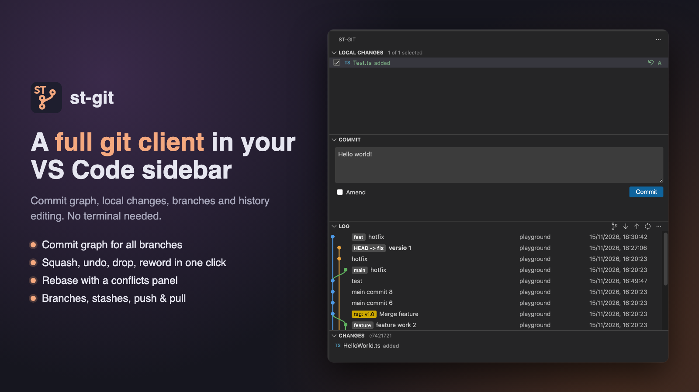

# st-git

Git client for VS Code: a commit graph with history editing, local changes with checkboxes, branches, stashes and conflict resolution, all in one sidebar.

Feels familiar if you are coming from IntelliJ IDEA or Android Studio.

## Features

**Log**
- Commit graph for all branches
- Right-click a commit: Undo Commit, Squash Commits, Edit Commit Message, Drop Commit, Cherry-Pick, Revert Commit
- Rebase Current Branch onto This, Reset Current Branch to Here, Compare with Current Branch
- Changes panel: files of the selected commit with diff

**Local Changes & Commit**
- Pick files to commit with checkboxes
- Commit message, Amend, Rollback
- Push, Pull, Fetch

**Branches**
- Branch list, Checkout, New Branch
- Current branch in the status bar

**Rebase & Conflicts**
- Continue / Abort rebase
- Conflicts panel: Accept Current, Accept Incoming, Merge

**Stashes**
- Stash Changes, Apply, Pop, Drop

## Requirements

- `git` available in `PATH`
- A folder with a git repository opened in VS Code

## History rewriting

Squash, rebase, undo, drop and message edits rewrite history. st-git asks for confirmation first and warns when the commits are already pushed (you will need to force-push afterwards).

## Support

st-git is free. If it saves you time, you can [support its development](https://boosty.to/andpall) ❤
